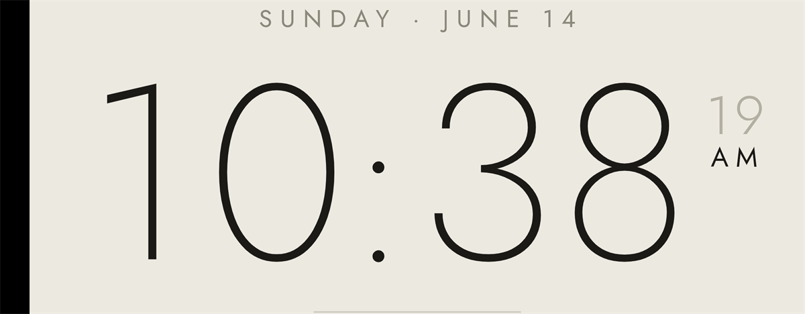
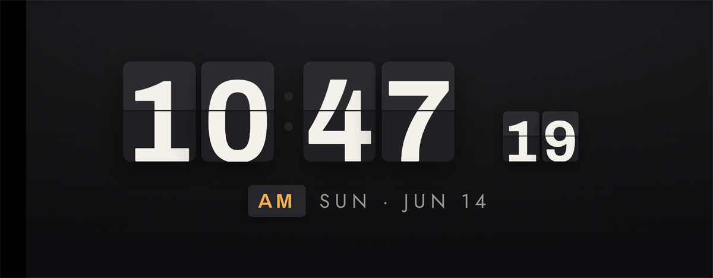
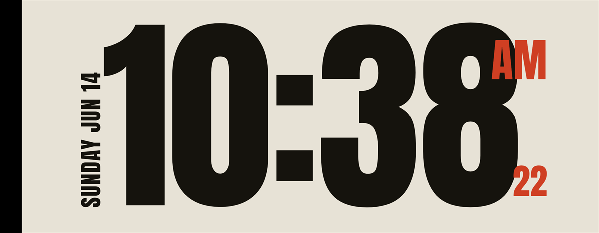
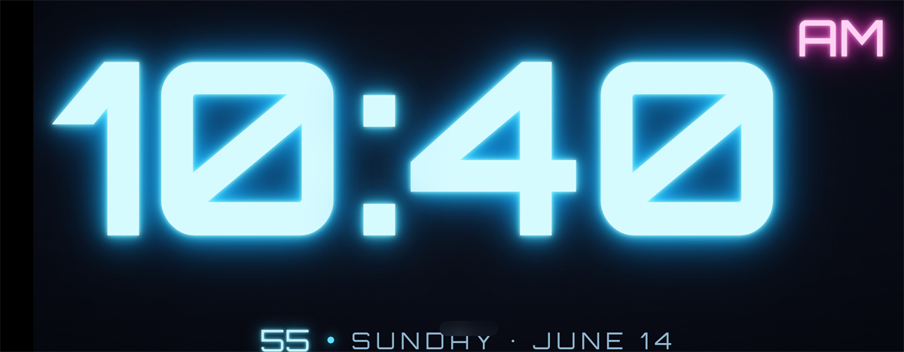

# Desk Clock 🕐

## Windows 데스크톱 위젯

Sonar 감지·초음파 출력·마이크 캡처와 테스트 화면은 제거했습니다. Android 앱은 녹음 권한을 요청하지 않으며 Windows 앱도 장치 접근 권한을 허용하지 않습니다.

기존 시계 화면을 Electron 창에서 사용할 수 있습니다. Node.js 설치 후:

Windows 기본 화면은 민트색 반투명 패널과 7세그먼트 숫자로 구성한 LCD 위젯입니다. 둥근 모서리 바깥은 완전히 투명하며 배경 불투명도를 숫자와 별도로 조절할 수 있습니다. 기존 페이스는 우클릭 메뉴 또는 설정의 **시계 페이스**에서 이름으로 직접 선택합니다. LCD 위젯은 화면 버튼 없이 우클릭과 트레이 메뉴로 관리합니다.

Windows의 모든 페이스에 민트 위젯과 같은 모서리 곡률·테두리 두께·투명한 바깥 영역을 적용합니다. 테두리는 각 디자인의 강조색(핑크, 앰버, 시안, 초록, 바이올렛 등)을 사용합니다.

가독성을 위해 기본 배경 불투명도는 96%, 전체 불투명도는 100%입니다. 초기 반투명 테마 설정은 업데이트 후 한 번 이 값으로 보정하며 이후의 사용자 변경은 유지합니다.

기본 위젯 크기는 360×141px이며, Galaxy Z Fold5 외부 화면(2316×904, 가로 약 2.562:1) 비율을 사용합니다. 기본 비율에서는 최소 180×70px까지 줄일 수 있고, 설정의 비율 유지를 해제하면 180×60px까지 자유롭게 조절할 수 있습니다. 우클릭/트레이의 **크기** 메뉴에서 작게(240×94), 보통(360×141), 크게(480×187)를 선택하거나 설정의 크기 슬라이더·너비·높이를 사용하세요. **시계 페이스** 메뉴와 설정에서 기존 7종(Minimal, Retro Flip, Typography, Neon, Terminal 등)을 직접 선택할 수 있습니다. 폴드 전용 3D 페이스는 Android 기기에서만 표시됩니다.

```powershell
npm install
npm start
```

- 테두리 없는 시계 화면을 드래그해 이동하며 위치와 크기는 자동 저장됩니다.
- 시계의 모든 페이스에서 우클릭하면 트레이와 동일한 메뉴가 열립니다. 왼쪽 버튼 드래그는 창 이동으로, 오른쪽 버튼은 메뉴로 분리되어 동작합니다.
- 화면 오른쪽 위의 **설정** 또는 우클릭 메뉴에서 항상 위, 너비·높이, 글자색·배경색, 불투명도(20–100%), Windows 로그인 시 자동 실행을 설정합니다.
- **다음 시계** 버튼과 방향키로 페이스를 전환합니다. 기본 색상 복원도 가능합니다. 글자색은 HTML 텍스트에 적용되며 캔버스/3D 그래픽의 재질 색상은 유지됩니다.
- Windows에서는 좌우 방향키와 **다음 시계** 버튼이 민트 LCD 위젯을 포함한 8종 전체를 순환합니다.
- 작업 표시줄에는 표시하지 않습니다. 트레이 메뉴로 시계 표시·숨기기, 설정, 종료를 관리합니다. 트레이 아이콘 더블클릭은 시계를 다시 표시합니다.
- 모니터 연결이 해제되거나 화면 밖 위치가 저장된 경우 사용 가능한 화면 안으로 위치를 보정합니다.
- 설정은 Windows 사용자 프로필의 Electron `userData` 폴더에 `widget.json`으로 저장됩니다.

배포용 실행 파일 생성:

```powershell
npm run build:windows
```

`release/`에 포터블 EXE가 생성됩니다. 자동 실행 설정 후에는 EXE 위치를 유지하세요. 개발 실행의 자동 실행은 현재 Electron 실행 파일과 프로젝트 경로를 사용합니다.

기존 Android 빌드와 `app/` 화면은 그대로 사용할 수 있습니다.

여러 시계 페이스를 넘기며 보는 **미니멀 탁상시계**. 단일 HTML 화면을 Capacitor WebView로 감싼 **오프라인 Android 앱(APK)** 입니다. 네트워크 없이 동작합니다.

화면을 **터치하면 다음 시계로 전환**되고, 선택한 페이스는 다음에 다시 켜도 유지됩니다. 전체화면·다크 대응으로 책상 위 상시 디스플레이(예: 폴드 커버 화면)에 잘 어울립니다.

## 시계 페이스

아래 캡처는 갤럭시 Z 폴드5 **커버 화면(가로 2316×904)** 에서 찍은 것입니다.

### 1. Minimal — 미니멀
얇은 Jost 서체의 따뜻한 페이퍼 톤. 날짜·초·AM/PM을 곁들인 단정한 구성.



### 2. Retro Flip — 레트로 플립
접혔다 펴지는 split-flap 애니메이션의 기계식 플립 시계.



### 3. Typography — 타이포그래피
Anton 대형 활자의 에디토리얼 포스터. 세로 날짜와 버밀리언 포인트.



### 4. Neon — 네온
Orbitron 서체에 시안/마젠타 글로우를 입힌 네온사인 시계.



## 주요 기능

- **4가지 시계 페이스** — 화면 터치(또는 ← / → 키)로 순환 전환
- **선택 유지** — 마지막 페이스를 `localStorage`에 저장해 재실행 시 복원
- **전체화면** — 상태바·내비게이션바를 숨긴 몰입형(immersive) 모드
- **화면 꺼짐 방지** — 상시 켜두는 탁상시계용으로 화면이 자동으로 꺼지지 않음
- **완전 오프라인** — 폰트까지 앱에 내장해 네트워크 없이 동작
- **광폭 화면 대응** — 폴드 커버 화면 같은 초광폭 비율에서 콘텐츠를 키워 화면을 채움

## 구조

```
app/                 WebView에 들어가는 화면 (= Capacitor webDir)
  index.html         4개 페이스 + 틱/전환/저장 로직 (단일 파일)
  fonts/             내장 폰트 (Jost·Archivo·Orbitron 가변 + Anton, woff2)
  manifest.json      웹 매니페스트
android/             Capacitor가 생성한 네이티브 Android 프로젝트
docs/DESIGN.md       페이스별 상세 디자인 사양서
screenshots/         위 캡처 이미지
```

## Android APK 빌드

[Capacitor](https://capacitorjs.com/) 기반입니다. **Node.js**, **JDK 17+**, **Android SDK**가 필요합니다.

```bash
npm install                       # 의존성 설치
npx cap copy android              # app/ 의 웹 에셋을 네이티브로 복사
cd android && ./gradlew assembleDebug
# 산출물: android/app/build/outputs/apk/debug/app-debug.apk
```

웹 에셋(`app/`)을 수정한 뒤에는 `npx cap copy android`로 다시 동기화하세요.

### 기기에 설치 (사이드로딩)

디버그 APK는 자체 서명되어 바로 사이드로딩할 수 있습니다. USB로 연결 후:

```bash
adb install -r android/app/build/outputs/apk/debug/app-debug.apk
```

> 디버그 빌드는 개인 사이드로딩/테스트용입니다. 스토어 배포에는 릴리스 서명이 별도로 필요합니다.

## 기술 노트

- **전체화면·배경**: 액티비티 테마를 `AppTheme.NoActionBar`(검정 배경)로 두고, `MainActivity`에서 `WindowInsetsControllerCompat`로 시스템 바를 숨기고 `FLAG_KEEP_SCREEN_ON`을 적용.
- **오프라인 폰트**: Google Fonts를 링크하지 않고 woff2를 `@font-face`로 내장. (오프라인에서 플립 숫자 정렬이 깨지던 문제 해결)
- **서비스워커 없음**: 번들 앱에서는 에셋이 이미 로컬이라 SW가 불필요하고 stale 캐시만 유발하므로 제거.

페이스별 색상·간격·애니메이션 등 상세 사양은 [docs/DESIGN.md](docs/DESIGN.md)를 참고하세요.

비율 기준: [삼성 Galaxy Z Fold5 공식 화면 사양](https://news.samsung.com/global/samsung-galaxy-z-flip5-and-galaxy-z-fold5-delivering-flexibility-and-versatility-without-compromise). 크기 슬라이더와 너비·높이 변경 시에도 기본적으로 이 비율을 유지합니다.
